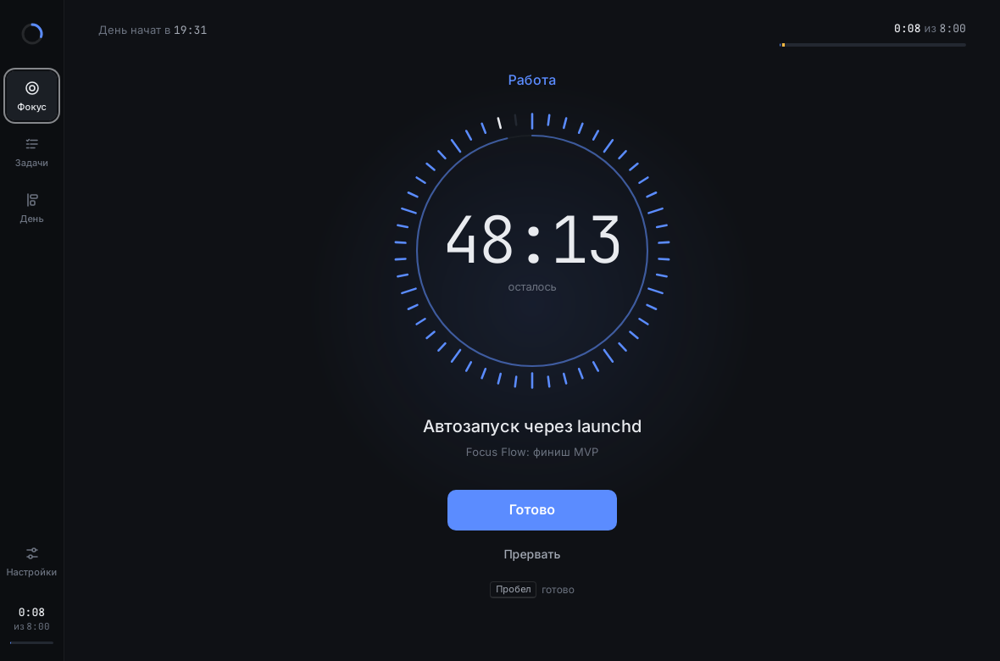
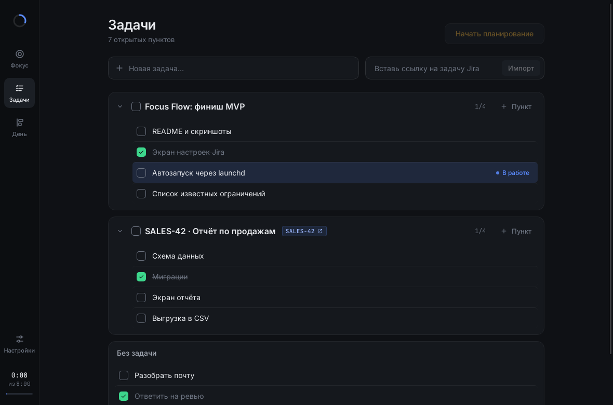
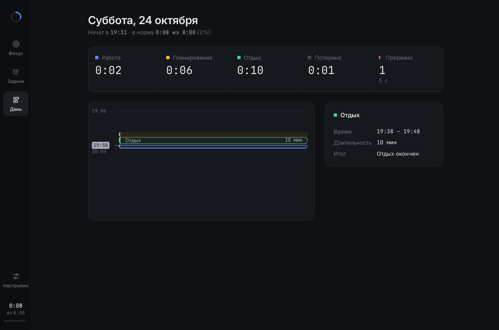
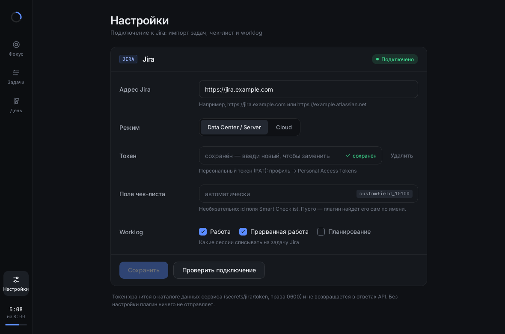

# Focus Flow

Трекер фокуса 50/10. Работаешь 50 минут над одним пунктом, потом 10 минут отдыхаешь. Паузы нет. Трекер показывает, набрана ли норма дня (по умолчанию 8 часов). Всё работает локально: сервис на Axum + SQLite (`127.0.0.1:7878`), desktop-клиент на Dioxus. Ещё к сервису подключаются Claude через MCP и плагин Jira (импорт задач, чек-лист, worklog).

Спецификация — [`docs/SPEC.md`](docs/SPEC.md), решения — [`docs/DECISIONS.md`](docs/DECISIONS.md), ограничения — [`docs/KNOWN-ISSUES.md`](docs/KNOWN-ISSUES.md).

| Фокус: идёт работа | Задачи |
|---|---|
|  |  |
| **День** | **Настройки Jira** |
|  |  |

Скриншоты с префиксом `real-` сняты на настоящем сервисе. Настройки и остальные состояния (простой, выбор пункта, отдых, планирование, «Готово», «Прервать») сняты на моке и лежат в [`docs/screenshots`](docs/screenshots).

## Установка

Нужны:

- Rust stable (`rustup`; версия задана в `rust-toolchain.toml`).
- Linux: WebKitGTK и сопутствующие пакеты для окна, например на Debian/Ubuntu: `sudo apt install libwebkit2gtk-4.1-dev libgtk-3-dev libxdo-dev libayatana-appindicator3-dev` (последний — для трея). На macOS ничего ставить не нужно.
- По желанию — Dioxus CLI `dx` 0.7 (`cargo install dioxus-cli`), нужен для hot reload и для сборки переносимого пакета.

## Запуск одной командой

```sh
cargo run -p focus-flow -- ui
```

Команда открывает окно и значок в трее (строке меню). Если сервис на `127.0.0.1:7878` не отвечает, она поднимает его в этом же процессе и штатно останавливает при выходе из приложения. Закрытие окна только прячет его, выход — «Выход» в трее или ⌘Q (подробнее — в разделе [«Трей / строка меню»](#трей--строка-меню)). Если сервис уже запущен (например, через launchd), окно подключится к нему.

Другие команды:

```sh
cargo run -p focus-flow -- serve    # только сервис: REST + SSE + MCP
cargo run -p focus-flow -- token    # показать токен доступа
cargo install --path bin/focus-flow # поставить `focus-flow` в ~/.cargo/bin
```

У `serve`, `ui` и `token` есть флаги `--addr` и `--data-dir` (переменные окружения — `FOCUS_ADDR` и `FOCUS_DATA_DIR`). Сервис без окна и без WebKit (например, для VDS) собирается так: `cargo build -p focus-flow --no-default-features --features mcp,jira`.

Бинарник из `cargo build` берёт CSS и шрифты из исходников (`apps/ui/assets`). Переносимый пакет с ассетами внутри собирается командой `cd apps/desktop && dx bundle`.

## Данные и токен

Данные лежат в системном каталоге:

| ОС | Каталог |
|---|---|
| Linux | `~/.local/share/focus-flow` |
| macOS | `~/Library/Application Support/dev.FocusFlow.focus-flow` |

Внутри: `focus.db` (SQLite), `token` и `secrets/` (токен Jira). Права у файлов с токенами — `0600`. Токен доступа создаётся при первом запуске. REST, SSE и MCP требуют заголовок `Authorization: Bearer <токен>`, свободен только `GET /api/health`. Сервис слушает только loopback и проверяет `Host` и `Origin`. Если удалить файл `token`, при следующем запуске создастся новый токен.

## Подключение Claude (MCP)

MCP доступен на `http://127.0.0.1:7878/mcp` (Streamable HTTP), сервис должен быть запущен.

**Claude Code:**

```sh
claude mcp add --transport http focus-flow http://127.0.0.1:7878/mcp \
  --header "Authorization: Bearer $(focus-flow token)"
```

**Claude Desktop** подключает HTTP-серверы с заголовком через мост [`mcp-remote`](https://www.npmjs.com/package/mcp-remote) (нужен Node.js). Добавь в `claude_desktop_config.json` (Settings → Developer → Edit Config):

```json
{
  "mcpServers": {
    "focus-flow": {
      "command": "npx",
      "args": ["-y", "mcp-remote", "http://127.0.0.1:7878/mcp", "--header", "Authorization:${FOCUS_AUTH}"],
      "env": { "FOCUS_AUTH": "Bearer <вывод focus-flow token>" }
    }
  }
}
```

Инструменты:

| Инструмент | Что делает |
|---|---|
| `get_status` | текущая сессия, `ends_at`, `remaining_sec`, отработано и норма; `events` — что случилось с прошлого вызова |
| `open_day` · `close_day` | открыть или закрыть сегодняшний день |
| `list_tasks` · `add_task` · `update_task` | дерево задач; задача или пункт (`parent_id`); правка |
| `start_work(item_id)` · `finish_item(next)` · `interrupt` | работа, «Готово» (дальше `rest` или `planning`), «Прервать» |
| `start_planning` · `stop` · `start_rest` | планирование, его остановка, отдых |
| `get_day_report(date?)` | итоги дня |
| `jira_import(url)` · `jira_sync()` · `jira_status()` | от плагина Jira |

## Настройка Jira

В приложении: **Настройки** (внизу боковой панели) → адрес Jira, режим, токен → «Сохранить» → «Проверить подключение». Если всё верно, появится имя пользователя Jira.

- **Data Center / Server** — персональный токен (PAT): аватар → Profile → Personal Access Tokens. Запросы идут с `Authorization: Bearer`.
- **Cloud** — API-токен (<https://id.atlassian.com/manage-profile/security/api-tokens>) и email учётной записи. Запросы идут с Basic `email:токен`.
- **Поле чек-листа** — необязательно: id текстового поля «Checklists» из Smart Checklist, запасной источник для чтения. Чек-лист плагин читает и пишет через свойство задачи `com.railsware.SmartChecklist.checklist`, как сам Smart Checklist. Если оставить поле пустым, плагин найдёт его сам по имени. Поле «Smart Checklist» на Data Center не подходит: оно для JQL и отдаёт не текст, а список объектов.
- **Отправка** — по умолчанию изменения копятся в очереди и уходят кнопкой «Отправить»; «Отправлять автоматически» — сразу.
- **Синхронизация** — по умолчанию изменения из Jira забираются кнопкой «Синхронизировать»; «Синхронизировать автоматически» — раз в 5 минут.
- **Worklog** — какие сессии списывать: работу, прерванную работу (обе по умолчанию включены), планирование (по умолчанию выключено).

Что делает плагин:

- Ссылка `https://<jira>/browse/KEY-1` или ключ `KEY-1` в поле импорта на экране «Задачи» создаёт задачу, а строки Smart Checklist становятся её пунктами. Повторный импорт догружает новые строки.
- Новый пункт добавляется в чек-лист строкой `- текст`, готовый пункт становится строкой `+ текст`, со снятой отметкой — снова `- текст`. Перед каждой записью чек-лист перечитывается.
- «Синхронизировать» перечитывает все открытые задачи из Jira: новое название (если вы его не меняли), новые строки, статусы строк, которые поменяли в Jira. Неотправленные изменения у нас и статусы, которые в Jira не менялись (например, отменённый у нас пункт), остаются.
- Закрытая сессия работы отправляется в worklog задачи (начало, длительность, текст пункта).

Если доставка не прошла, событие ждёт в очереди и повторяется. Ошибка и размер очереди видны в «Настройках». Без UI плагин настраивается через REST: `GET`/`PUT /api/plugins/jira/settings`, `POST /api/plugins/jira/test`, очередь — `GET /api/plugins/jira/queue`, `POST …/queue/send`, синхронизация — `POST /api/plugins/jira/sync`. Поля описаны в [`docs/DECISIONS.md`](docs/DECISIONS.md), раздел «шаг 7».

## Горячие клавиши

| Где | Клавиша | Действие |
|---|---|---|
| Фокус | Пробел / Enter | главное действие: выбрать пункт → начать → «Готово» → начать работу после планирования (там же кнопки «Отдых» и «Стоп») |
| Фокус | Esc | закрыть диалог или выбор пункта |
| Выбор пункта | ↑ ↓ · Enter | перейти по списку · выбрать |
| Задачи | Enter | создать задачу или пункт, импортировать ссылку |
| Задачи | Esc | отменить ввод пункта |
| Настройки | Enter | сохранить |

## Трей / строка меню

Как «Часы» в строке меню macOS: рядом со значком — текущая фаза и время.

| Фаза | Значок | Текст |
|---|---|---|
| работа | таймер | `49:55` — сколько осталось |
| отдых | чашка | `09:12` — сколько осталось |
| планирование | карандаш | `12:40` — сколько прошло (от часа — `1:02:05`) |
| простой | таймер контуром | — |
| нет связи с сервисом | перечёркнутый таймер | — |

Время берётся из того же состояния, что и окно (сервис + SSE): трей не ходит в сервис сам и не считает время отдельно.

**Левый клик** — показать окно на экране «Фокус». **Правый клик** — меню. В нём всегда есть «Открыть Focus Flow» и «Выход», а между ними — команды текущей фазы:

| Фаза | Команды |
|---|---|
| работа | «Готово» → «Отдых 10 минут» / «Спланировать следующую»; «Прервать…» |
| планирование | «Отдых», «Стоп», «Начать работу…» |
| простой | «Начать работу…», «Планировать» |
| отдых, нет связи | — |

Паузы нет. «Прервать…» из трея не прерывает: открывает окно с тем же предупреждением, что и кнопка «Прервать». «Начать работу…» открывает выбор пункта: без пункта работа не стартует. Остальные команды выполняются сразу, как кнопки экрана.

**Закрытие окна** (красная кнопка, ⌘W, крестик) только прячет его: таймер, живые обновления и встроенный сервис работают дальше. Вернуть окно — клик по значку, «Открыть Focus Flow» или (macOS) клик по значку в Dock. Полный выход — «Выход» в меню трея или ⌘Q; сервис, поднятый `focus-flow ui`, при этом штатно останавливается.

Различия ОС:

- **macOS** — чёрно-белый значок-шаблон (сам подстраивается под светлую и тёмную тему) и время рядом с ним моноширинными цифрами.
- **Linux** — цветной значок и подпись со временем. Подпись видна не везде: в GNOME с расширением AppIndicator (Ubuntu), Unity и XFCE indicator-plugin — да, в KDE и в обычной области уведомлений XFCE — нет. Подсказок и кликов по значку AppIndicator не знает: меню открывается любым кликом, окно — пунктом «Открыть». Нужна библиотека `libayatana-appindicator3-1` (или `libappindicator3-1`). Если у панели нет области значков (StatusNotifierWatcher), закрытие окна, как раньше, завершает приложение — иначе спрятанное окно было бы не вернуть.
- **Windows** — цветной значок, время и пункт — только во всплывающей подсказке: подписей у значков в трее Windows нет.

## Автозапуск на macOS

Сервис может стартовать при входе в систему через launchd. После этого `focus-flow ui` подключается к нему.

```sh
cargo install --path bin/focus-flow
sed "s|__HOME__|$HOME|g" scripts/macos/dev.focusflow.serve.plist > ~/Library/LaunchAgents/dev.focusflow.serve.plist
launchctl load -w ~/Library/LaunchAgents/dev.focusflow.serve.plist
curl -s http://127.0.0.1:7878/api/health   # {"status":"ok",...}
```

Остановить и убрать: `launchctl unload -w ~/Library/LaunchAgents/dev.focusflow.serve.plist`. Лог — `~/Library/Logs/focus-flow.log`.

## Режим мока (без сервиса)

Клиент может работать на `MockApi`: данные в памяти, живой таймер. Это удобно для демо и скриншотов.

```sh
FOCUS_MOCK=1 cargo run -p desktop
FOCUS_MOCK_SCENARIO=work FOCUS_MOCK_SPEED=60 cargo run -p desktop
```

- `FOCUS_MOCK=1` — включить мок.
- `FOCUS_MOCK_SCENARIO` — сценарий, тоже включает мок: `idle`, `work`, `rest`, `planning`, `empty`, `picker`, `interrupt`, `done-choice`, `tasks`, `day`, `settings`.
- `FOCUS_MOCK_SPEED` — во сколько раз часы мока быстрее реальных (`0` — часы стоят).
- `FOCUS_MOCK_JIRA=off` — Jira в моке не настроена.
- `FOCUS_WINDOW_SIZE=960x640` — размер окна.

Без мока клиент берёт адрес из `FOCUS_ADDR`, а токен — из `FOCUS_TOKEN` или из файла `token` в каталоге данных.

## Разработка

```sh
cd apps/desktop && dx serve          # окно с hot reload (сервис — отдельно: focus-flow serve)
cargo fmt --all
cargo clippy --workspace --all-targets -- -D warnings
cargo test --workspace
cd apps/desktop && dx build          # проверка сборки клиента
cargo check -p focus-api-types -p web --target wasm32-unknown-unknown
```

Сценарии контракта (`crates/api-contract-tests`) прогоняются на моке, на сервисе и, по желанию, на `HttpApi` против запущенного сервиса: `FOCUS_TEST_ADDR=127.0.0.1:7878 FOCUS_TEST_TOKEN=$(focus-flow token) cargo test -p ui -- --ignored`.

## Структура

```
crates/
  api-types           контракт: DTO, ApiError, трейт FocusApi, события SSE (собирается в wasm)
  api-contract-tests  сценарии поведения против &dyn FocusApi
  core                домен и правила таймера (без SQL и HTTP)
  storage             SQLite (sqlx), миграции, репозитории, outbox
  plugin-api          трейты Plugin и TaskSource, DomainEvent
  plugin-jira         плагин Jira
  api-rest            REST + SSE (Axum)
  api-mcp             MCP (rmcp)
  server              сборка сервиса: конфиг, токен, таймер, плагины
apps/
  ui                  общий интерфейс: экраны, компоненты, MockApi, HttpApi
  desktop             окно и трей (библиотека + main для dx)
  web, mobile         заготовки
bin/focus-flow        CLI: serve | ui | token
scripts/macos         шаблон launchd
docs/                 спецификация, план, решения, ограничения, скриншоты
```
